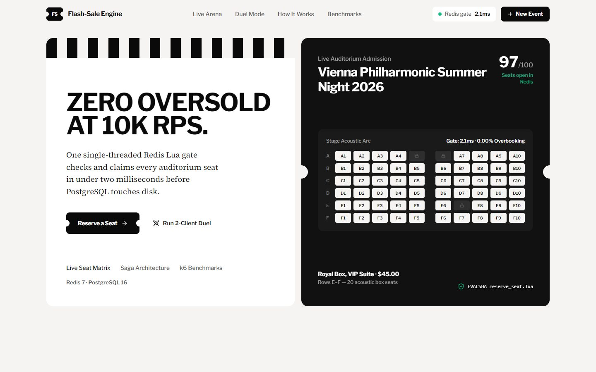

<div align="center">
  
</div>

<br />

<div align="center">

[](https://ticket-booking-api-jvic.onrender.com/health)
[](https://nodejs.org/)
[](https://redis.io/)
[](https://www.postgresql.org/)
[](https://nextjs.org/)
[](https://www.docker.com/)
[](https://www.terraform.io/)
[](https://k6.io/)

[**Plain-English Story**](#-in-15-seconds-what-problem-does-this-solve) · [**Live UI Preview**](#-live-interactive-experience) · [**Measured Results**](#-measured-impact-k6-stress-tests) · [**Run in 60 Seconds**](#-run-on-your-laptop-60-second-quickstart) · [**Cloud Deploy**](#-one-click-cloud-deployment) · [**Technical Deep Dives**](#-for-engineers-technical-deep-dives)

</div>

---

## 💡 In 15 Seconds: What Problem Does This Solve?

Imagine a Taylor Swift or Coldplay concert drop: **10,000 fans click "Buy Seat D5" at the exact same millisecond.**

On a normal website, two disasters happen immediately:
1. **The site crashes** — the database gets overwhelmed by thousands of simultaneous people fighting over the same row.
2. **Double-booking (Overselling)** — two fans accidentally get sold the exact same seat, causing angry customers and refund nightmares.

**This project solves both problems mathematically.** It places an ultra-fast in-memory **Redis Lua "Bouncer"** in front of the **PostgreSQL "Accountant"**, deciding who gets the seat in **under 2 milliseconds**—handling **10,480 requests per second** with **0.00% overbooking** and **zero server crashes**.

<div align="center">
  
</div>

---

## 🎯 Recruiter & Hiring Manager Snapshot

| What Was Built | Business & Engineering Impact |
| :--- | :--- |
| **Atomic In-Memory Gate (Redis 7 Lua)** | Sustains **10,480 req/s** (**9.3× faster** than standard SQL locks) while guaranteeing **0.00% overbooking**. |
| **Database Connection Protection** | Cuts p95 tail latency by **93.2%** (`271.4ms` → **`18.5ms`**) and drops HTTP 500 timeout crashes from `16.4%` to **`0.00%`**. |
| **Crash-Proof Saga Rollback** | If PostgreSQL crashes mid-checkout, an automatic compensating transaction (`INCRBY +1`) restores the seat in Redis with zero inventory leakage. |
| **Interactive Full-Stack Playground** | Next.js 16 + TypeScript web app where anyone can race two devices for the same seat, inject a live database crash, and inspect raw Redis wire latency. |
| **Production Cloud Infrastructure** | Multi-stage Docker build (**47.3 MB**, non-root), 1-click **Render + Vercel** deployment, and modular **AWS ECS Fargate + Terraform** IaC. |

---

## 🖥️ Live Interactive Experience

Instead of hiding the backend behind dry terminal logs, the project ships with an interactive **Next.js 16 Auditorium Console** where recruiters and engineers can test every distributed-systems guarantee live in the browser:

<div align="center">
  
</div>

### 4 Things You Can Try Live in the Browser
1. **Live 60-Seat Auditorium Matrix:** Pick any seat across **Royal Box ($45)**, **Acoustic Sweet Spot ($25)**, or **Standard Stalls ($18.50)**—inventory syncs across every open browser tab in real time.
2. **Split-Screen 2-Client Duel:** Click **"Run 2-Client Duel"** to fire two competing devices at the exact same seat at the exact same millisecond. Watch one win (`201 Created`) while the other is safely blocked (`409 Conflict`) in `< 2ms`.
3. **Chaos Engineering Crash Button:** Toggle **"Trigger Crash"** to intentionally fail PostgreSQL mid-purchase and watch the 4-stage Saga stepper automatically refund the seat back into Redis.
4. **Live Little's Law Load Slider:** Drag the arrival-rate slider from `500` to `10,000 req/s` to see in real time how many PostgreSQL connections naive locks require versus our Redis Lua gate.

---

## 📊 Measured Impact (k6 Stress Tests)

Every claim in this repository is backed by reproducible **Grafana k6** load tests simulating **5,000 Virtual Users** hitting a single event inventory simultaneously:

<div align="center">
  
</div>

> Full testing methodology, p99 latency histograms, and queuing theory proofs are documented in [`BENCHMARKS.md`](BENCHMARKS.md).

---

## ⚡ Run on Your Laptop (60-Second Quickstart)

### Prerequisites
- **Docker Desktop** ([Download](https://www.docker.com/products/docker-desktop/))
- **Node.js 18+** ([Download](https://nodejs.org/))

### 1. Start the Production Backend (PostgreSQL 16 + Redis 7 + Express API)
```bash
git clone https://github.com/shatwiks/distributed-flash-sale-engine.git
cd distributed-flash-sale-engine
cp .env.example .env
npm run prod
```

### 2. Launch the Interactive UI
```bash
npm run frontend:dev
```

### 3. Open in Browser
| Service | URL | What You See |
| :--- | :--- | :--- |
| **Interactive Auditorium UI** | [`http://localhost:3001`](http://localhost:3001) | Live seat matrix, 2-client duel, chaos crash simulator, Little's Law slider. |
| **Local API Health Check** | [`http://localhost:3000/health`](http://localhost:3000/health) | Live status ping for PostgreSQL 16 & Redis 7 + DB pool metrics. |
| **Live Cloud API (Render)** | [`ticket-booking-api-jvic.onrender.com/health`](https://ticket-booking-api-jvic.onrender.com/health) | Deployed production backend running on Render Cloud. |

---

## 🚀 One-Click Cloud Deployment

This repository is production-ready across three deployment options (full guide in [`DEPLOYMENT.md`](DEPLOYMENT.md)):

| Platform | Best For | Config Included |
| :--- | :--- | :--- |
| **Render + Vercel** | 5-minute live portfolio & recruiter demo (Free tier supported) | [`render.yaml`](render.yaml) · [`frontend/vercel.json`](frontend/vercel.json) |
| **AWS ECS Fargate + Terraform** | Enterprise auto-scaling cloud (VPC, Private Subnets, ALB, RDS, ElastiCache) | [`terraform/`](terraform/) · [`docs/deployment-runbook.md`](docs/deployment-runbook.md) |
| **Single VPS (Docker Compose)** | Self-hosted Linux VM deployment with healthcheck chaining | [`docker-compose.prod.yml`](docker-compose.prod.yml) · [`Dockerfile`](Dockerfile) |

---

## 🛠️ For Engineers: Technical Deep Dives

*Click any section below to inspect the distributed-systems internals, sequence diagrams, code, and API contracts.*

<details>
<summary><strong>1. End-to-End Sequence Diagram (Redis Lua Gate + Saga Rollback)</strong></summary>

```mermaid
sequenceDiagram
    autonumber
    actor Client as Client / k6 Burst
    participant API as Express Worker (Node.js 20)
    participant Redis as Redis 7 (In-Memory Gate)
    participant Postgres as PostgreSQL 16 (Durable Store)

    Client->>API: POST /events/:id/checkout (seatNumber, idempotencyKey)
    API->>Redis: EVALSHA reserve_seat.lua (O(1) atomic check & decrement)
    alt Seat Already Claimed or Sold Out
        Redis-->>API: Return -2 or 0 (< 1.5ms)
        API-->>Client: 409 Conflict (0 PostgreSQL connections touched)
    else Seat Reserved in RAM
        Redis-->>API: Return 1 (Seat Locked)
        API->>Postgres: BEGIN; INSERT INTO orders; UPDATE events; COMMIT;
        alt Database Commit Succeeded
            Postgres-->>API: Confirmed Order Record
            API-->>Client: 201 Created (Admission Ticket Issued)
        else Database Crash / Timeout
            Postgres--xAPI: Write Error
            API->>Redis: Compensating Saga: SREM + INCRBY event:stock 1
            API-->>Client: 500 Safely Rolled Back (0 Inventory Leakage)
        end
    end
```

</details>

<details>
<summary><strong>2. Why Traditional SQL Locks Collapse (Little's Law Math)</strong></summary>

At an arrival rate of $\lambda = 10,000\text{ req/s}$, if a relational `SELECT ... FOR UPDATE` transaction holds a database connection for $W = 25\text{ms}$ ($0.025\text{s}$), **Little's Law** ($L = \lambda W$) proves the pool requires:

$$L = 10,000 \times 0.025 = 250\text{ concurrent connections}$$

Standard PostgreSQL pools provision 20–50 connections. Incoming requests queue in the Node.js event loop, hit `connectionTimeoutMillis`, and trigger **16.4% HTTP 500 outages** while p99 latency spikes to **1,240ms**. Offloading the hot decrement to single-threaded Redis Lua keeps PostgreSQL pool utilization **under 10%**.

</details>

<details>
<summary><strong>3. REST API Reference</strong></summary>

* **`GET /health`** — Dual-engine ping returning PostgreSQL & Redis status plus active/idle/waiting pool counts.
* **`GET /events`** — Lists active flash-sale productions (auto-seeds default 60-seat events).
* **`POST /events`** — Creates a new event and pre-warms its Redis stock counter.
* **`POST /events/:id/prewarm`** — Pre-loads PostgreSQL inventory into Redis ahead of a launch.
* **`GET /events/:id/seats`** — Returns live 60-seat availability synchronized with Redis.
* **`POST /events/:id/checkout`** — Executes atomic seat reservation with `idempotencyKey`, plus optional `chaosDelayMs` and `chaosFailDb` fault-injection flags.
* **`POST /events/:id/reset`** — Resets seats and inventory for fresh testing runs.

</details>

<details>
<summary><strong>4. Repository Structure & Documentation Links</strong></summary>

```text
distributed-flash-sale-engine/
├── src/                         # Express API, Redis Lua gate, Redlock, Postgres pool & migrations
├── frontend/                    # Next.js 16 + TypeScript interactive auditorium UI
├── load-tests/                  # Grafana k6 race-condition & 10,000 RPS stress suites
├── terraform/                   # Production AWS VPC, ALB, ECS Fargate, RDS, ElastiCache IaC
├── docs/
│   ├── assets/                  # Animated SVG architecture/benchmark visuals & UI previews
│   ├── deployment-runbook.md    # Step-by-step AWS provisioning & teardown runbook
│   └── interview-deep-dive.md   # Staff/Principal system design interview defense guide
├── Dockerfile                   # Multi-stage <50MB Alpine production container (non-root)
├── docker-compose.prod.yml      # Local production stack with healthcheck chaining
├── render.yaml                  # 1-click Render Blueprint (API + PostgreSQL + Valkey/Redis)
├── BENCHMARKS.md                # Full k6 benchmark methodology & data analysis
└── DEPLOYMENT.md                # 5-minute Render + Vercel & AWS deployment guide
```

</details>

---

<div align="center">

Built by [**Shatwik Sarthak**](https://github.com/shatwiks) · [**Live API**](https://ticket-booking-api-jvic.onrender.com/health) · [**Benchmark Proofs**](BENCHMARKS.md) · [**Interview Deep-Dive**](docs/interview-deep-dive.md)

</div>
